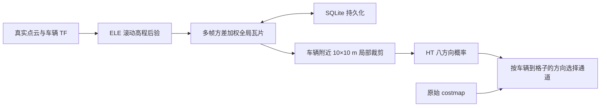

# Scout 全局高程与局部 HT

2026-10-27：复用 ELE Scout Kit 的 CUDA 高程建图及磁盘瓦片累积器，
新增 Scout 坐标会话管理、同原点恢复和融合缓存失效处理。



同一次全局坐标会话中，车辆离开滚动窗口后，已观测高程仍保留在全局瓦片中。
局部裁剪直接读取累计全局图，不使用单帧点云重新代替全局历史。
瓦片只融合本帧确实更新的高程格，避免重复发布同一后验时反复增加观测次数。
保留 ELE 的方差加权、方差下限 0.0025 m²、异常门限 3σ 和最大高度冲突 0.30 m。
这些是融合参数，不能解释为已经完成现场高度精度标定。

2026-10-28 最新配置：全局高程先验 `global_map_initial_elevation=-1.0 m`、
`global_map_initial_variance=10000.0 m²`。首次真实观测也经过卡尔曼更新，
不再直接覆盖先验；10000 不受观测方差的 4.0 m² 上限截断。
按 2026-10-28 最新要求，Scout 开启 `global_map_publish_unobserved_prior=true`：
未观测格对外输出高度 -1 m、方差 10000 m²，同时保持观测次数为 0。
这让初始先验平面可见，真实测量仍由 `observation_count>0` 区分。
后续方差下限仍为 0.0025 m²，异常门限仍为 3σ / 最大高度冲突 0.30 m。
先验参数纳入会话标识，配置变化会建立独立数据库；旧数据库保留。
本次已将相同坐标会话的历史实测值迁移到新配置，仅将未观测格的先验改为 -1 m。
同一新配置后续重启会恢复后验，不会每次把已观测格重置为初始高度。
局部 CUDA 高程图的 `initial_variance=1000.0` 保持原值，本次修改针对全局图。

2026-10-29：修复全局高值被异常门限永久锁住的问题。
正常融合仍使用 3σ / 0.30 m 门限；超出门限的实测值建立临时候选，
同一格累计 10 次与候选均值相差不超过 0.10 m 的真实更新后，替换旧后验。
候选矛盾或收到与旧值一致的测量时重新计数；两次候选更新相隔超过 50 个全局更新版本
时重新计数。未扫描格不增加票数，普通重复发布不参与确认。
候选仅保存在有界瓦片缓存中，重启后重新收集；已确认的纠正结果正常持久化。
异步融合日志中的 `corrected_cells` 是本进程累计纠正的格子次数。

这三个纠错参数纳入坐标会话标识。采用新参数后会建立干净会话，
不迁移此前含错误高值的历史数据；原库仍保留在 NVMe。
新会话初始高度为 -1 m、方差 10000 m²，随后由真实扫描逐格更新。

2026-10-29 射线清除补充：仅靠新落点纠错无法消除没有再次收到地面落点的行人残影。
CUDA 现在把真实射线穿过格子时的高度上界一同传给全局累积器。
连续 3 批快照确认射线从历史高度下方至少 0.15 m 穿过后，撤销该旧高度，
恢复 -1 m / 10000 m² / `observation_count=0` 的未观测先验。
同一帧的有效落点优先；GPU 也抑制在有异常端点的格子上导出清除证据。
没有新射线、射线没有从旧高度下方穿过、滚动窗口移位以及方差过期，都不构成清除证据。
本轮迁移完整保留现场高度瓦片，仅新增射线策略元数据，没有通过清空地图消除残影。

Scout 输入点云在 `base_link` 下，但射线从真实 `rslidar` TF 位置出发；
`ray_origin_frame=rslidar` 与清除参数一起纳入会话标识。
若雷达原点 TF 不可用，则等待 TF，避免使用错误起点进行清除。
日志中的 `cleared_cells` 为本进程累计撤销次数，可能包含同一格多次撤销，
不能当作不重复格子的数量。原始 costmap 的障碍仍优先禁止通行。

2026-10-30 射线证据 v2：上一版仍复用了局部可见性过滤后的上界，
导致法向缺失、法向与射线垂直、局部格刚更新这三个分支漏掉全局清除证据。
现在 CUDA 使用独立的原始射线几何上界，再由端点优先、0.15 m 高差和三批确认
判断全局撤销；局部法向/更新时间过滤不再挡住全局证据。
会话标识新增 `ray_evidence_version=2`；本机已将此前同坐标会话的全部瓦片原样迁移。
实际走人复测与限制见 [验证记录](validation/dynamic_clearance_20261030/REPORT.md)。

## 启动及保存

Autoware 正常启动后，在相同 ROS 环境运行：

```bash
cd /mnt/nvme0n1/autoware/autoware.scout
./start_scout_ht.bash start_elevation:=true start_ht:=true rviz:=false
```

若已有相同入口运行，不要重复执行。
该入口沿用终端的 ROS 域和 RMW，不启动另一套底盘、雷达或独立导航控制器。

默认保存到 NVMe：

```text
/mnt/nvme0n1/autoware/scout_elevation_maps/<session_id>/
  session.json          # 实际 FP_ENU0 ECEF 原点、分辨率、外参校验和及融合配置
  mapping.params.yaml   # 此会话实际传给 ELE 的参数
  tiles.sqlite3         # 高程、方差、累计观测次数、最后更新版本
```

可通过 `SCOUT_HT_MAP_ROOT=/指定目录 ./start_scout_ht.bash ...` 或
`global_map_root:=/指定目录` 更换根目录。
同一个 Fix 原点和外参配置会恢复已有数据库；原点或外参变化则另建坐标会话，
不会把旧坐标的数据直接拼接到新坐标中。新会话、未观测区域仍需要积累真实数据。
高程节点异常退出时，管理节点先让融合输出失效，再退避重启并恢复同一数据库。
Fix 未全局初始化时管理节点等待；初始化失效时停止高程节点，避免继续写入未初始化坐标。

## 数据及显示

| 话题 | 含义 |
|---|---|
| `/elevation_mapping_node/elevation_map_global_tiles` | 已分配全局瓦片的 MarkerArray 可视化 |
| `/elevation_mapping_node/elevation_map_global` | 全局图随车移动的 15×15 m 查看窗口，原为 30×30 m；并非存储范围上限 |
| `/elevation_mapping_node/elevation_map_global_local` | 从全局图裁出的 10×10 m 局部 GridMap，输入 HT |
| `/scout/ht/raw` | 八方向 HT 原始概率和代价 |
| `/scout/elevation/status` | 坐标会话、数据库路径及高程进程状态 |
| `/scout/traversability/fused_costmap` | 原始 costmap 与当前局部 HT 的融合结果 |

两个高程 GridMap 均含 `elevation`、`variance`、`observation_count`、`last_update_revision`。
在 RViz 中添加 MarkerArray，选择 `elevation_map_global_tiles` 可观察所有已记录的瓦片，
Fixed Frame 使用 `map`。

HT 输入分辨率为 0.04 m；其 51×51 感受野使 10×10 m 输入的外侧约 1 m 无评分，
内部最大有效输出约 8×8 m。融合原始 costmap 约 70×70 m。
Scout 当前开启 `unobserved_is_free=true`，未观测、未形成有效 HT 结论及 HT 覆盖外区域
采用可通行先验；已有有效 HT 低评分的格和原始 costmap 障碍仍保持不可通行。
HT 的 `ht_observed` / `ht_prior_free` 层明确区分实测区域与先验，原始模型概率不伪造为 1。
缺失输入、数据过期、非法数据及坐标错误仍单独报告并使输出失效，不使用先验掩盖故障。
这里保存的是全局高程；没有把过去某次“朝某方向可通行”的二值结果永久写白。
HT 仍按当前车辆位置到目标格子的方位选方向，且原始 costmap 障碍继续优先禁止。

## 本次验证

完整本地 Python 回归 76 项通过；ELE 全局地图原有测试 24 项通过。
保留并迁移了现场原数据库，验证此前使用的两张地图与当前真实 FP_ENU0 原点相同。
随后只重启一次高程节点，恢复同一个数据库：已观测格从 216262 增至 216695，
累计观测次数继续增长，没有清空地图。详细数据及快照见
[验证记录](validation/global_elevation_20261027_165608/REPORT.md)。
